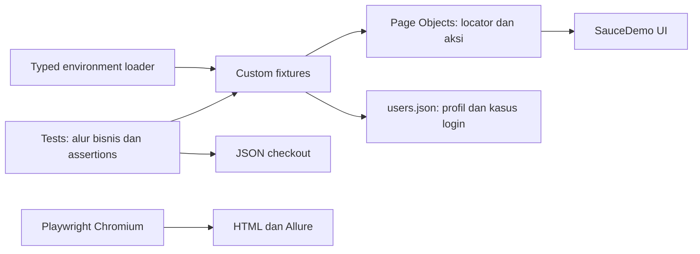

# SauceDemo Web UI Automation

[](https://github.com/faisalakmal/Playwright-Typescript-Web/actions/workflows/playwright.yml)

Automation Web UI untuk [SauceDemo](https://saucedemo.com) menggunakan Playwright, TypeScript strict, custom fixtures, Page Object Model, ESLint, Prettier, dan Allure. Hanya Chromium yang dijalankan.

## Arsitektur



```text
.github/workflows/playwright.yml
src/
  fixtures/base.fixture.ts
  pages/{base,login,inventory,cart,checkout}.page.ts
  test-data/{users,checkout,checkout-negative}.json
  utils/env.config.ts
tests/ui/*.spec.ts
playwright.config.ts
```

Page Objects tidak berisi assertions. Setiap test menggunakan context terisolasi dan fixtures untuk dependency injection. Locator mengutamakan role dan data-test; tidak ada static wait. Fokus proyek hanya Web UI.

## Setup lokal

Prasyarat: Node.js 22+, npm, dan Java 17+ untuk membuat/membuka Allure Report.

```bash
npm install
cp .env.example .env
npx playwright install chromium
```

Isi password demo pada bagian DEV, STAGING, dan PRODUCTION dalam satu file .env. Hanya .env.example yang masuk Git. Password/token tidak disimpan dalam JSON.

## Satu file environment

.env.example menyediakan tiga bagian yang disalin ke satu .env:

| Pilihan    | Prefix konfigurasi                                                                                 |
| ---------- | -------------------------------------------------------------------------------------------------- |
| dev        | DEV_BASE_URL, DEV_ACCOUNT_MODE, DEV_SAUCE_PASSWORD                                                 |
| staging    | STAGING_BASE_URL, STAGING_ACCOUNT_MODE, STAGING_SAUCE_PASSWORD                                     |
| production | PRODUCTION_BASE_URL, PRODUCTION_ACCOUNT_MODE, PRODUCTION_SAUCE_PASSWORD, PRODUCTION_SAUCE_USERNAME |

TEST_ENV memilih bagian yang digunakan. Prioritas pemilihan: TEST_ENV terminal/CI → TEST_ENV di .env → dev. Perintah test:dev/staging/production memilih environment secara eksplisit.

Nilai konfigurasi dipilih dari variabel terminal/CI tanpa prefix (misalnya BASE_URL), lalu variabel terminal dengan prefix (misalnya STAGING_BASE_URL), lalu bagian terpilih di .env. Bagian environment lain tidak menjadi fallback. File .env.dev, .env.staging, dan .env.production tidak digunakan.

```bash
npm test                       # TEST_ENV dari .env; default dev
npm run test:dev                # Paksa dev
npm run test:staging
npm run test:production
npm run test:smoke              # 1 test
npm run test:regression         # 10 test dalam mode demo
npx playwright test --grep @negative # 7 test negatif dalam mode demo
npm run test:headed
npm run test:ui
npm run typecheck
npm run lint
npm run format:check
```

Semua profil template saat ini mengarah ke SauceDemo publik yang sama. Memilih profil berbeda tidak menciptakan deployment terpisah; ganti URL dan kredensial jika deployment terpisah tersedia.

## Profil akun dan data test

users.json menggabungkan enam profil demo publik (standard, lockedOut, problem, performance, error, visual) dan negativeCases untuk input login salah/kosong. Test login negatif mengambil users.negativeCases; fixture account mengambil username dari users.standard dan password dari environment. Fixture account hanya memuat kredensial; ekspektasi perilaku dibaca langsung oleh test dari users.json. Test akun terkunci memakai username dan pesan error dari users.lockedOut.

Password diambil dari environment. ACCOUNT_MODE=demo adalah default untuk semua profil. ACCOUNT_MODE=real hanya diterima pada production dan memerlukan PRODUCTION_SAUCE_USERNAME di .env, atau SAUCE_USERNAME dari secrets CI. Mode real mengganti username alur normal dan melewati test akun terkunci yang khusus demo. Aplikasi target tetap harus mempunyai kontrak UI yang sesuai dengan Page Objects proyek ini.

Profil problem, performance, error, dan visual sudah terdaftar, tetapi belum memiliki skenario khusus. Test tidak otomatis diulang untuk semua profil.

## Cakupan dan tag

| Skenario                                                               | Jumlah | Tag                           |
| ---------------------------------------------------------------------- | ------ | ----------------------------- |
| Tambah produk, hapus, kembali ke katalog                               | 1      | @smoke, @regression           |
| Checkout lengkap, validasi input, subtotal/pajak/total, konfirmasi     | 1      | @regression                   |
| Batalkan checkout dan pertahankan isi keranjang                        | 1      | @regression                   |
| Password salah, username kosong, password kosong; lalu login valid     | 3      | @negative, @regression        |
| Validasi firstName, lastName, postalCode secara terpisah; lalu koreksi | 3      | @negative, @regression        |
| Akun terkunci ditolak; akun standar tetap bisa login                   | 1      | @demo, @negative, @regression |

Total mode demo: 10 test Chromium. Suite ini masih merupakan portofolio awal, bukan cakupan regresi seluruh aplikasi. SauceDemo tidak mempunyai pencarian; alur E2E menggunakan pengurutan katalog.

## Laporan

```bash
npm run report:html
npm run report:allure
npm run report:allure:open
```

Folder hasil Allure mentah dibersihkan otomatis sebelum setiap run agar hasil beberapa run tidak tercampur. Hasil Allure mentah berada di allure-results/, HTML Allure di allure-report/, dan HTML Playwright di playwright-report/. Screenshot hanya saat gagal, video dipertahankan saat gagal, dan trace direkam pada retry pertama. Lokal default tanpa retry; gunakan npx playwright test --retries=1 untuk trace retry. Metadata laporan Playwright mencantumkan environment dan baseURL.

## GitHub Actions

[Repository](https://github.com/faisalakmal/Playwright-Typescript-Web) · [Workflow dan artifact](https://github.com/faisalakmal/Playwright-Typescript-Web/actions/workflows/playwright.yml)

Push ke main dan pull request memakai environment dev. Run manual menyediakan pilihan dev/staging/production. GitHub Environments masing-masing menyimpan:

| Jenis    | Nama           | Fungsi                          |
| -------- | -------------- | ------------------------------- |
| Variable | BASE_URL       | Target aplikasi                 |
| Variable | ACCOUNT_MODE   | demo atau real; default demo    |
| Secret   | SAUCE_PASSWORD | Password akun                   |
| Secret   | SAUCE_USERNAME | Hanya mode real pada production |

CI tidak memerlukan file .env. Pipeline menjalankan npm ci, typecheck, lint, format, instalasi Chromium beserta dependensi sistem, dan test headless dengan dua retry. Java disiapkan untuk menghasilkan Allure HTML.

Langkah upload memakai if: always() dan menyimpan laporan serta debugging artifacts selama 14 hari. Buka Actions → run → Artifacts, lalu unduh playwright-ui-report-dev/staging/production. Ekstrak dan buka laporan:

```bash
npx allure open <lokasi>/allure-report
npx playwright show-report <lokasi>/playwright-report
```

Pemilihan production saat ini tetap menjalankan alur checkout pada demo publik. Tentukan cakupan yang sesuai sebelum mengganti target dengan production nyata.
