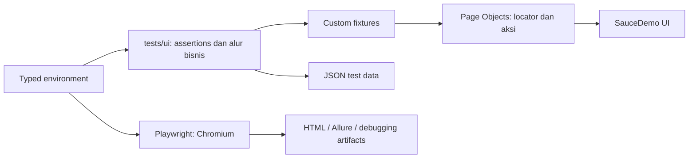

# SauceDemo Web UI Automation

[](https://github.com/faisalakmal/Playwright-Typescript-Web/actions/workflows/playwright.yml)

Kerangka automation Web UI untuk [SauceDemo](https://saucedemo.com), menggunakan Playwright, TypeScript strict, dotenv, ESLint, Prettier, HTML reporter, dan Allure.

## Arsitektur



```text
.github/workflows/playwright.yml
src/
  fixtures/base.fixture.ts
  pages/{base,login,inventory,cart,checkout}.page.ts
  test-data/{checkout,login-negative,checkout-negative}.json
  utils/env.config.ts
tests/ui/*.spec.ts
playwright.config.ts
```

Setiap test memakai browser context baru. Page Objects diinjeksikan lewat fixtures dan tidak berisi assertions. Target dan kredensial dimuat melalui konfigurasi environment; data produk serta pelanggan berada pada JSON. Selector mengutamakan role dan kontrak data-test. Tidak ada static wait.

## Setup lokal

Prasyarat: Node.js 22 atau lebih baru dan npm. Allure CLI memerlukan Java 17+ untuk membuat/membuka laporan.

```bash
npm install
cp .env.example .env
npx playwright install chromium
```

Isi SAUCE_USERNAME dan SAUCE_PASSWORD di .env dengan akun demo standar yang ditampilkan pada halaman login SauceDemo. BASE_URL sudah dicontohkan di .env.example. File .env diabaikan Git. Variabel shell/CI mengalahkan .env.

```bash
npm test                 # Semua skenario pada Chromium
npm run test:chromium    # Chromium saja
npm run test:headed      # Browser terlihat
npm run test:ui          # Playwright UI mode
npm run typecheck
npm run lint
npm run format:check
npm run format
```

## Skenario checkout

Satu skenario E2E mencakup login lewat UI, pengurutan harga, penambahan dua produk, pemeriksaan keranjang, validasi penolakan form pelanggan kosong, pengisian pelanggan, pemeriksaan subtotal/pajak/total, penyelesaian pesanan, konfirmasi pengiriman, dan kembali ke katalog dengan keranjang kosong.

SauceDemo tidak menyediakan pencarian produk; skenario memakai pengurutan katalog. Validasi negatif form kosong disertakan dalam alur yang sama. Ini kerangka awal dengan sembilan test case, belum merupakan suite regresi lengkap. Tidak ada setup API atau penyimpanan sesi bersama.

## Laporan

```bash
npm run report:html
npm run report:allure
npm run report:allure:open
```

HTML ada di playwright-report/, hasil Allure di allure-results/, dan laporan Allure yang dihasilkan di allure-report/. Screenshot hanya saat gagal; video dipertahankan saat gagal; trace direkam pada retry pertama. Lokal secara default tidak melakukan retry; gunakan npx playwright test --retries=1 jika membutuhkan trace retry.

## GitHub Actions

Workflow berjalan saat push ke main, pull request, atau workflow_dispatch. Pada Settings → Secrets and variables → Actions, atur:

| Jenis               | Nama           | Nilai                                |
| ------------------- | -------------- | ------------------------------------ |
| Repository variable | BASE_URL       | URL SauceDemo dari .env.example      |
| Repository secret   | SAUCE_USERNAME | Akun demo standar dari halaman login |
| Repository secret   | SAUCE_PASSWORD | Password demo dari halaman login     |

Pipeline menjalankan npm ci, pemeriksaan TypeScript/lint/format, instalasi browser beserta dependensi sistem, kemudian test headless pada Chromium dengan dua retry. Langkah upload memakai if: always() dan menyimpan HTML report, hasil Allure mentah, laporan Allure HTML, serta debugging artifacts selama 14 hari.

Buka tab Actions → pilih workflow run → Artifacts → unduh playwright-ui-report-dev. Ekstrak lalu jalankan npx playwright show-report <lokasi>/playwright-report. Untuk Allure, jalankan npx allure generate <lokasi>/allure-results --clean -o allure-report lalu npm run report:allure:open. CI menyimpan hasil Allure mentah dan laporan Allure HTML. Untuk melihat laporan yang sudah dibuat CI, ekstrak artifact lalu jalankan npx allure open <lokasi>/allure-report.

## Smoke dan regression

Tag berlaku pada test case, sehingga satu file pun dapat berisi beberapa kategori. Suite ini memakai file terpisah agar cakupan mudah terlihat:

| File                    | Skenario                                                             | Tag                 |
| ----------------------- | -------------------------------------------------------------------- | ------------------- |
| cart.spec.ts            | Tambah produk, hapus dari keranjang, kembali ke katalog              | @smoke, @regression |
| checkout-cancel.spec.ts | Batalkan checkout, pastikan produk tetap ada, mulai checkout kembali | @regression         |
| e2e-checkout.spec.ts    | Checkout lengkap dengan validasi input dan total pesanan             | @regression         |

Smoke menjalankan satu test case per browser. Regression menjalankan sembilan test case, termasuk smoke. Setiap test login sendiri melalui UI dan tidak bergantung pada test lain.

```bash
npm run test:smoke                         # 1 case pada Chromium = 1 eksekusi
npm run test:regression                    # 9 case pada Chromium = 9 eksekusi
npm run test:smoke -- --project=chromium    # 1 eksekusi
npm run test:regression -- --project=chromium # 9 eksekusi
npm run test:smoke -- --list               # Lihat test yang dipilih tanpa menjalankan browser
```

Workflow CI tetap menjalankan seluruh suite melalui npm test.

## Pengujian negatif dan bukti hasil

Enam test negatif menggunakan data eksternal pada src/test-data/login-negative.json dan src/test-data/checkout-negative.json:

| Area     | Kasus                                                   | Pemulihan yang diperiksa              |
| -------- | ------------------------------------------------------- | ------------------------------------- |
| Login    | Password salah, username kosong, password kosong        | Login ulang dengan kredensial valid   |
| Checkout | First name kosong, last name kosong, postal code kosong | Perbaiki input dan lanjut ke overview |

Setiap field checkout diuji sendiri dengan field lainnya terisi. Test memeriksa pesan kesalahan dan memastikan navigasi tertahan, lalu membuktikan pengguna dapat melanjutkan setelah koreksi.

```bash
npx playwright test --grep @negative # 6 test negatif
npm test                            # 9 test pada Chromium
```

[Repository](https://github.com/faisalakmal/Playwright-Typescript-Web) · [Workflow dan artifact laporan](https://github.com/faisalakmal/Playwright-Typescript-Web/actions/workflows/playwright.yml)

Badge di bagian atas README menampilkan status workflow sebenarnya. Pilih run terbaru di Actions untuk melihat langkah pemeriksaan dan mengunduh artifact playwright-ui-report-dev berisi Playwright HTML, Allure HTML, hasil Allure mentah, dan artefak debugging bila test gagal. Laporan tidak disimpan sebagai source code di Git.

Cakupan saat ini berfokus pada Chromium desktop dan sembilan test case; belum mencakup seluruh kombinasi data, browser, atau perangkat.

## Data login valid

Kredensial login valid bersumber dari SAUCE_USERNAME dan SAUCE_PASSWORD di .env lokal atau secrets GitHub Actions. Nilai tersebut diekspor sebagai env.username dan env.password melalui src/utils/env.config.ts dan dipakai seluruh test yang memerlukan login. Kredensial tidak disimpan di JSON test data.

Untuk SauceDemo, gunakan akun demo standar yang ditampilkan pada halaman login. File login-negative.json hanya menentukan variasi input salah/kosong; nilai valid tetap diambil dari environment. Jika konfigurasi belum lengkap, loader menampilkan nama variabel yang harus diisi. File .env lokal tidak masuk commit.

## Environment dev, staging, dan production

Pemilihan environment sudah tersedia melalui TEST_ENV. Default adalah dev.

| Perintah                | File lokal      | GitHub Environment |
| ----------------------- | --------------- | ------------------ |
| npm run test:dev        | .env.dev        | dev                |
| npm run test:staging    | .env.staging    | staging            |
| npm run test:production | .env.production | production         |

Setup lokal:

```bash
cp .env.dev.example .env.dev
cp .env.staging.example .env.staging
cp .env.production.example .env.production
# Isi BASE_URL, SAUCE_USERNAME, dan SAUCE_PASSWORD di masing-masing file.
npm run test:dev
npm run test:staging -- --grep @smoke
npm run test:production -- --grep @smoke
```

Untuk kompatibilitas setup lama, dev membaca .env jika .env.dev belum tersedia. Staging dan production tidak memakai fallback .env. Nilai shell/CI diprioritaskan atas file; pastikan tidak mengekspor BASE_URL atau kredensial environment lain sebelum menjalankan test. Nilai TEST_ENV di luar tiga pilihan ditolak.

Ketiga template memakai URL SauceDemo yang sama karena proyek ini belum memiliki deployment dev/staging/production terpisah. Profil berbeda tidak menciptakan deployment baru. Ganti BASE_URL dan akun pada setiap profil untuk mengarah ke lingkungan aplikasi sebenarnya. Seluruh file lokal berisi kredensial diabaikan Git; hanya template kosong yang di-commit.

Pada GitHub Settings → Environments, gunakan dev, staging, dan production. Masing-masing menyimpan variable BASE_URL serta secrets SAUCE_USERNAME dan SAUCE_PASSWORD. Environment values mengalahkan repository values dengan nama sama. Trigger push/PR memakai dev. Untuk staging/production: Actions → Playwright UI Tests → Run workflow → pilih environment. Ketiga pilihan menjalankan suite yang sama; profil production demo ini juga mengandung checkout. Sesuaikan cakupan sebelum memakai target production yang memiliki transaksi nyata.

Laporan HTML Playwright menyertakan environment dan baseURL pada metadata. Artifact CI diberi nama playwright-ui-report-dev, playwright-ui-report-staging, atau playwright-ui-report-production.

### Penyimpanan data akun

Password, token, serta username akun nyata tetap berada di file environment lokal atau secrets CI. JSON dipakai untuk data skenario, input negatif, dan ekspektasi. Daftar username demo publik seperti standard_user dan locked_out_user boleh dicatat sebagai profil di users.json, tetapi akun dengan perilaku khusus memerlukan skenario dan ekspektasi tersendiri. Suite saat ini memakai satu akun standar dari SAUCE_USERNAME; enam profil SauceDemo belum semuanya diuji.
